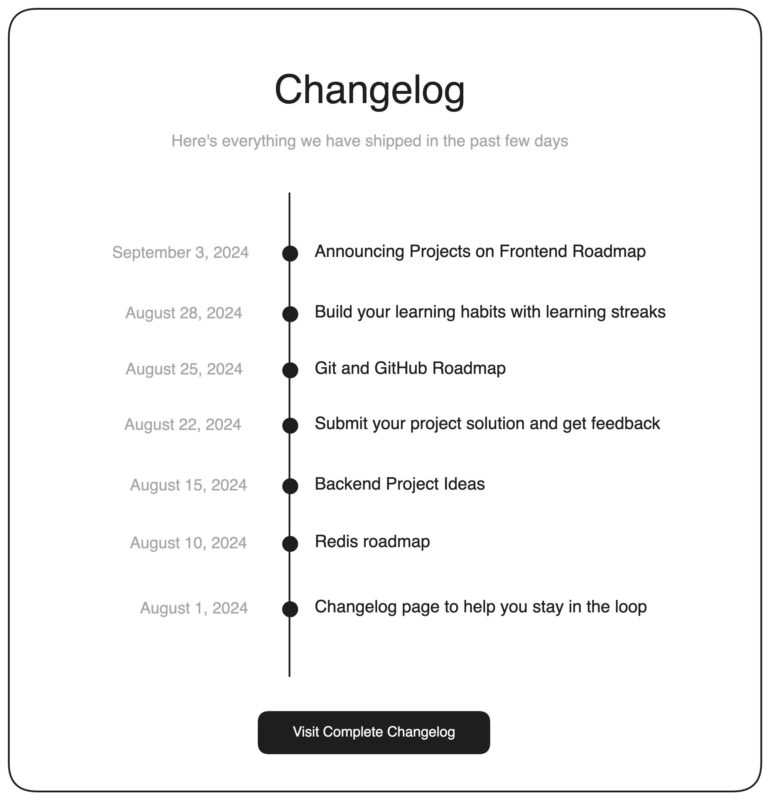

# 04 · Changelog Component

| 字段 | 值 |
| --- | --- |
| 级别 | `beginner` |
| 主题 | HTML · Layout · CSS · Flexbox |
| 项目网址 | <https://roadmap.sh/projects/changelog-component> |
| 状态 | ✅ 已完成 |

**原文题目**：Create a changelog component for a website using HTML and CSS

**题意**：用 HTML + CSS 做一个「更新日志（changelog）」组件。

## 目标

> The goal of this project is to teach you about positioning and layout in CSS. You will create a simple HTML structure and use CSS to style it into a visually appealing and responsive changelog component.

题面开头的定义也值得记一下：

> A changelog is a log or record of all notable changes made to a project or software. It is often used to keep users informed about the latest updates and improvements.

也就是说：**这题练的是定位与布局**，成品要像真实产品里的「更新日志」区块。

参考 mockup（官方原图已存为本目录的 [mockup.png](mockup.png)）：

从图里能拆出三层结构：

| 区域 | 内容 | 布局要点 |
| --- | --- | --- |
| 标题区 | `Changelog` + 一句副标题 | 居中，副标题弱化 |
| 时间线 | 日期（左）\| 圆点 + 竖线（中）\| 变更条目（右） | 三列，或两列 + 定位线 |
| 底部 | `Visit Complete Changelog` 按钮 | 居中，与列表留出间距 |

> 原图地址：<https://assets.roadmap.sh/guest/changelog-component-1m86j.png>

官方还明确说了：

> Feel free to customize the design and layout of the component as you see fit. The focus should be on creating a well-structured and responsive component that can be easily integrated into a website.

所以：**设计自由，结构、响应式、可嵌入是硬指标**。

## 官方要求

这题**没有提交清单**（不像 01/02/03 那样列出 checklist），页面上只给了三条信息：

1. 用 HTML + CSS 制作一个 changelog 组件。
2. 组件要**结构良好、响应式**，能方便地嵌进任意网站。
3. 布局与设计可自由发挥，重点是练 CSS 定位与排版。

> ⚠️ 下面「验收」里的条目是**我们自己补的**，不是官方要求，别当成硬性标准。

## 提示

- 变更记录用 `<ol>`（有先后顺序）承载，每条一个 `<li>`；版本号和日期用 `<time datetime="2025-01-12">`。
- 时间线的竖线和圆点，两种常见做法：
  - `li { position: relative; padding-left: 2rem }` + `li::before` 画点、`li::after` 或容器 `border-left` 画线；
  - 或整列用 `border-left` + 每条用 `::before` 定位到线上。
- 这题的关键词是 **positioning**：`relative` 定位父级 + `absolute` 定位子元素，是 mockup 里「点对齐到日期行」的常规解法。
- 组件要能嵌入：宽度用 `%` / `max-width` 自适应，**不要**直接给 `body` 写死布局，也不要用只在本页成立的全局选择器。
- 文案建议直接用真实内容 —— 比如本项目 01→02→03 的版本记录，比 lorem ipsum 有说服力。
- 版本号、日期、条目三者的层级要稳定：日期/版本弱化（小字、次要色），变更条目为主体。
- 别忘 `box-sizing: border-box`；`padding-left` 留出的时间线空间要和线宽、点大小算在一起。
- 无 JS 需求的纯展示组件，别引入脚本。

## 实现

- 入口：`index.html`
- 样式：`style.css`
- 技术：纯 HTML + CSS
- 运行方式：直接双击打开 / `npx serve .`

## 验收（自定，非官方）

- [x] 至少 3 条变更记录，每条含日期 / 具体变更（本实现用日期作主轴，与 mockup 一致）
- [x] 时间线视觉（圆点 + 竖线）对齐稳定，不依赖固定高度
- [x] 375 / 768 / 1280 三个宽度下都没有横向滚动条（窄屏改为左侧时间线）
- [x] 组件样式挂在 `.changelog` 上，页面级只做居中展示
- [x] 用键盘 Tab 时焦点落在底部链接，顺序与视觉一致；`:focus-visible` 有描边
- [x] HTML 过 W3C Nu（`messages: []`），CSS 过 [W3C CSS Validator](https://jigsaw.w3.org/css-validator/)（CSS 3 + SVG，恭喜通过）
- [x] 浏览器 console 无报错（无 JS）

## 笔记

完整知识点整理见 **[NOTES.md](NOTES.md)**：可嵌入组件结构、`relative`/`absolute`、伪元素、Grid 时间线、中心对齐、窄屏改布局、`:focus-visible`、校验方法与踩坑 —— 尽量附官方文档出处。

### 1. 这题核心三件事

| 关键词 | 做法 |
| --- | --- |
| positioning | 列表/条目 `relative`，竖线与圆点用伪元素 `absolute` |
| responsive | 宽屏两列居中线；窄屏线靠左、日期在上 |
| integrable | 样式挂在 `.changelog`，`body` 只做演示居中 |

### 2. 时间线怎么画

- 一个 `<ol>`，每条 `<li>` 里是 `<time>` + 文案
- `ol::before` 画竖线（`top` + `bottom` 拉满，不写死高度）
- `li::before` 画圆点；`left: 50%` + `translate(-50%)` 让**中心**落在线上

### 3. 窄屏对齐坑（必记）

竖线若写 `transform: none`、圆点仍保留 `translate(-50%)`，点和线会错位。两边要用同一套「中心对准同一个 `left`」的算法。

### 4. 校验

- HTML：W3C Nu → `messages: []`
- CSS：W3C CSS Validator（CSS 3 + SVG）→ 通过
