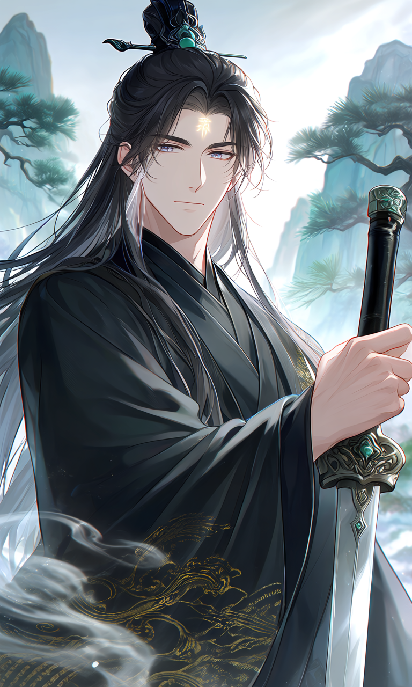

# 05 · Testimonial Cards — 知识点笔记（零基础版）

> **给谁看的**：完全可以零基础。如果你还不熟 HTML/CSS，就按顺序往下读；每节都先讲「屏幕上你会看到什么」，再讲代码。
>
> **怎么用**：一边打开本目录的 [index.html](index.html)、[style.css](style.css) 和 [mockup.png](mockup.png)，一边对照。
>
> **标记**：
> - **是什么**：第一次出现的概念
> - **建议**：常见好做法（不是考试硬规定）
> - **注意**：容易踩的坑
>
> 上一题笔记：[04 · Changelog](../04-changelog-component/NOTES.md)（时间线、伪元素画线）。本题继续练布局，但换成「好几张长得不一样的卡片」。

---

## 目录

1. [用大白话说：这题在干什么](#1-用大白话说这题在干什么)
2. [先认图：四种卡片分别长什么样](#2-先认图四种卡片分别长什么样)
3. [文件从哪开始读](#3-文件从哪开始读)
4. [全局小设定：盒模型与重置](#4-全局小设定盒模型与重置)
5. [第一种卡：气泡 + 小三角](#5-第一种卡气泡--小三角)
6. [第二种卡：白底描边卡](#6-第二种卡白底描边卡)
7. [第三种卡：左图右文（同高是难点）](#7-第三种卡左图右文同高是难点)
8. [第四种卡：看起来像轮播](#8-第四种卡看起来像轮播)
9. [整页怎么摆：画廊 Grid](#9-整页怎么摆画廊-grid)
10. [一点点无障碍](#10-一点点无障碍)
11. [踩坑合集（现象 → 原因 → 改法）](#11-踩坑合集现象--原因--改法)
12. [读完自检](#12-读完自检)
13. [参考资料](#13-参考资料)

---

## 1. 用大白话说：这题在干什么

### 是什么：Testimonial（评价 / 口碑）

网站上常见一种模块：显示「真实用户怎么说我们的好话」。

通常会有：

- 一段评价文字  
- 说话的人的头像  
- 姓名  
- 职位（比如 Junior Frontend Developer）

这类模块就叫 **testimonial cards（评价卡片）**。

### 官方要你练什么

官方原文大意是：练 CSS 的 **定位（positioning）** 和 **布局（layout）**；并且 mockup 里**每张卡布局都不一样**。

所以：

| 不是目标 | 才是目标 |
| --- | --- |
| 做三张长得一模一样、只换名字的卡 | 做几种**结构不同**的卡 |
| 像素级抄死官方图 | 搞懂 Flex、定位、伪元素怎么排版 |
| 一定要写 JavaScript 做真轮播 | 轮播那张做成「看起来像轮播的静态画面」就行 |

文案、头像官方说可以随便换。我们用了自己的 `image.png` 和 MoYun 相关文案。

---

## 2. 先认图：四种卡片分别长什么样

对照 [mockup.png](mockup.png)，从上到下大致是：

```text
┌─────────────────┐  ┌─────────────────┐
│ 黑气泡 + 文字    │  │ 白卡 + 黑边框    │
│       ▼尖角      │  │ 文字             │
│ 头像  姓名职位   │  │ 头像 姓名职位    │
└─────────────────┘  └─────────────────┘
        ↑ 第一种              ↑ 第二种

┌──────────┬──────────────────────────┐
│          │ ★★★★★                     │
│  大图     │ 姓名 / 职位                │
│          │ 评价文字…                  │
└──────────┴──────────────────────────┘
              ↑ 第三种（左图右文，要同高）

┌─────────────────────────────────────┐
│           评价文字（居中）             │
│      ‹   ○  ⬤  ○   ›                 │
│             姓名                     │
└─────────────────────────────────────┘
              ↑ 第四种（像轮播，但本项目是静态）
```

本项目对应类名：

| 顺序 | 类名前缀 | 你在 HTML 里找 |
| --- | --- | --- |
| 1 | `card-bubble-` | `.card-bubble-wrap` |
| 2 | `card-border-` | `.card-border-wrap` |
| 3 | `card-split-` | `.card-split-wrap` |
| 4 | `card-carousel-` | `.card-carousel-wrap` |

**建议**：类名全部用英文小写 + **单个连字符 `-`**（如 `card-border-quote`）。不要混用双下划线 `__`，否则 HTML 写一套、CSS 写另一套，样式对不上还不好查。

---

## 3. 文件从哪开始读

```text
05-testimonial-cards/
├── index.html    ← 结构：四种卡的 HTML
├── style.css     ← 样子：颜色、Flex、定位
├── image.png     ← 头像 / 大图（可换成你自己的）
├── mockup.png    ← 官方参考图
├── README.md     ← 题目与验收
└── NOTES.md      ← 你正在看的这份
```

打开方式：双击 `index.html`，或在本目录执行 `npx serve .` 再用浏览器打开。

页面最外层是：

```html
<main class="gallery">
  <!-- 四张卡的 section 依次排在这里 -->
</main>
```

`.gallery` 负责「整页怎么摆」；每一张卡内部再用自己的类负责「这一张内部怎么排」。

---

## 4. 全局小设定：盒模型与重置

文件开头有：

```css
*,
*::before,
*::after {
  box-sizing: border-box;
  margin: 0;
  padding: 0;
}
```

### 是什么：`box-sizing: border-box`

想象一个盒子：

- **默认（content-box）**：你说宽 100px，再加 padding、边框，**总宽度会超过 100px**。窄屏上很容易撑出横向滚动条。
- **border-box**：你说宽 100px，padding 和边框**算在 100px 里面**，总宽就是 100px。

`*` 表示「所有元素」；`*::before` / `*::after` 表示伪元素也一起算（后面画尖角会用到伪元素）。

`margin: 0; padding: 0` 是清掉浏览器默认内外边距，避免「我没写间距却空出一块」的困惑。

参考：[MDN box-sizing](https://developer.mozilla.org/en-US/docs/Web/CSS/Reference/Properties/box-sizing)

---

## 5. 第一种卡：气泡 + 小三角

### 5.1 HTML 在说什么

结构可以想成两层：

```text
.card-bubble
├── .card-bubble-quote     ← 黑色圆角「气泡」（评价文字在里面）
└── .card-bubble-person    ← 气泡下面：头像 + 姓名 + 职位
```

尖角**不在 HTML 里写三角形标签**，而是用 CSS 在气泡上「画」出来。

头像旁边已经有姓名文字时，图片用 `alt=""`：读屏软件就不会把图片再念一遍「莫名其妙的文件名」，避免重复吵闹。

### 5.2 气泡本体

```css
.card-bubble-quote {
  position: relative;   /* ① 很重要：给尖角当「坐标原点」 */
  padding: 1.25rem 1.5rem;
  border-radius: 1rem;
  background-color: #111;
  color: #fff;
}
```

| 属性 | 人话 |
| --- | --- |
| `position: relative` | 这个盒子自己还在正常文档流里；但作为「爸爸」，让里面的绝对定位孩子以它为参照 |
| `padding` | 文字离边框的内边距，别贴边 |
| `border-radius` | 圆角 |
| `background` / `color` | 黑底白字 |

### 5.3 是什么：伪元素 `::after`

浏览器可以在元素内容的**后面**凭空多出一个小盒子，不用你在 HTML 里写 `<span class="triangle">`。

规则：

1. 必须写 `content: ""`（哪怕是空字符串），否则伪元素不出现。  
2. 本项目用 `::after` 画尖角；用 `::before` 也可以，绝对定位后差别不大。

### 5.4 小三角怎么「画」出来（border 法）

```css
.card-bubble-quote::after {
  content: "";
  position: absolute;
  left: 1.2rem;              /* 尖角左右位置：对准头像可微调 */
  bottom: -12px;             /* 贴在气泡底边外侧 */
  width: 0;
  height: 0;
  border-left: 12px solid transparent;
  border-right: 12px solid transparent;
  border-top: 12px solid #111;  /* 有颜色的这边 = 尖的朝向相关 */
}
```

#### 原理（请慢慢看）

1. 把伪元素的宽高都设成 `0` → 中间没有「内容面积」。  
2. 只给它四条边框。边框在拐角处会斜切。  
3. 左右边框设成**透明**，上边框设成**和气泡一样的黑色** → 你只看见一块朝下的黑三角。

```text
        透明        透明
           ╲      ╱
            ╲    ╱
             ╲  ╱
              ╲╱
           有色的上边框
           → 看起来像 ▼
```

| 你想让尖朝哪 | 通常给哪一边上颜色 |
| --- | --- |
| 朝下 | `border-top` |
| 朝上 | `border-bottom` |
| 朝左 | `border-right` |
| 朝右 | `border-left` |

#### 为什么要 `position: absolute`？

- 三角要「挂」在气泡底边外面，不能挤开文字。  
- `absolute` = 脱离正常排队，按爸爸（`relative` 的气泡）的边来定 `left` / `bottom`。

**注意**：如果忘了给气泡写 `position: relative`，尖角可能跑到更外层去对坐标，位置会飞。

### 5.5 头像那一行：Flex 横排

```css
.card-bubble-person {
  display: flex;
  align-items: center; /* 头像和文字垂直居中对齐 */
  gap: 0.75rem;        /* 头像和文字之间的缝 */
  margin-top: 1.25rem; /* 和气泡（含尖角）拉开一点距离 */
}
```

### 是什么：Flex（弹性布局）

把一个容器设成 `display: flex` 后，它的直接孩子会排成一行（默认）或一列，并可用简单属性控制对齐和间距。

| 属性 | 人话 |
| --- | --- |
| `align-items: center` | 交叉轴居中（横排时就是上下居中） |
| `gap` | 子元素之间的空隙，比到处写 margin 干净 |

圆形头像：

```css
.card-bubble-avatar {
  width: 4rem;
  height: 4rem;
  border-radius: 50%; /* 正方形 + 50% = 圆 */
  display: block;
}
```

**建议**：头像再加 `object-fit: cover`，照片不会被压扁，多出来的部分裁掉。若你注释掉了它，长方形原图可能变形或裁切不如预期。

---

## 6. 第二种卡：白底描边卡

### 和第一种的关键差别

| | 气泡卡 | 描边卡 |
| --- | --- | --- |
| 头像在哪 | 在气泡**外面**、尖角下面 | 在白卡**里面**、文字下面 |
| 有没有尖角 | 有 | 没有 |
| 外观 | 黑底 | 白底 + 黑边框 |

### 结构

```text
.card-border（白卡片）
├── .card-border-quote   ← 评价
└── .card-border-person  ← 头像 + 姓名 + 职位（footer）
```

```css
.card-border {
  max-width: 22rem;
  padding: 1.25rem 1.5rem;
  background: #fff;
  border: 2px solid #111;
  border-radius: 1rem;
}
```

页脚同样用 Flex 横排，写法与气泡卡的 person 行几乎一样——这是故意的：你会发现「头像+文字横排」是可复用的小模式。

```css
.card-border-quote p + p {
  margin-top: 0.75rem;
}
```

**是什么：`p + p`（相邻兄弟选择器）**  
「前面刚好也是 `p` 的那个 `p`」才加间距。这样第一段上面不会多空，第二段与第一段之间才有空隙。

---

## 7. 第三种卡：左图右文（同高是难点）

这是本题最容易卡住的一块。请务必读完。

### 7.1 我们想要的效果

```text
┌──────────┬─────────────────────┐
│          │ ★★★★★               │
│  大图     │ 姓名                 │  ← 左右两块要一样高
│          │ 评价…                │
└──────────┴─────────────────────┘
```

右边文字多，盒子就高；左边图也要被「拉」到同样高度，多出来的画面用裁切填满。

### 7.2 HTML 为什么多包一层

```html
<article class="card-split">
  <div class="card-split-media">   <!-- 外包层：普通 div -->
    
  </div>
  <div class="card-split-panel">   <!-- 右侧文字面板 -->
    …
  </div>
</article>
```

### 7.3 Flex 同高：先说「正常情况」

```css
.card-split {
  display: flex;
  align-items: stretch; /* 同一行里，孩子们在竖直方向被拉成一样高 */
  gap: 1rem;
}
```

### 是什么：`align-items: stretch`

在横向 Flex 里：

- 主轴 = 左右  
- 交叉轴 = 上下  

`stretch` = 在交叉轴上**拉长**，让矮的孩子跟最高的那个一样高。

Flex **默认**就是 `stretch`。但如果你写成 `align-items: center`，就变成「各用各的高度、垂直居中」，**左右不会同高**。

### 7.4 为什么直接 stretch `` 经常失败？

### 是什么：替换元素（replaced element）

``、`<video>` 这类标签，内容来自外部文件，浏览器心里有一张「照片本来的宽高比」。

你可以跟 Flex 说「请拉伸」，但很多浏览器会优先**保住照片比例**，结果是：

- 右边文字面板很高  
- 左边图片还是「自己舒服的高度」  
- 看起来就是**左右不齐**

所以：**不是 Flex 坏了，是 img 比较倔。**

### 7.5 标准稳妥改法（本项目采用）：外包层 + 绝对定位铺满

分三步理解：

**第一步**：让 Flex 去拉伸**普通 div**（`.card-split-media`）。普通盒子没有「照片比例包袱」，会老老实实跟右栏一样高。

```css
.card-split-media {
  position: relative;   /* 给里面的 img 当定位爸爸 */
  width: 12rem;
  flex-shrink: 0;       /* 别被挤扁变窄 */
  border-radius: 1rem;
  overflow: hidden;     /* 圆角外的图裁掉 */
}
```

**第二步**：让图片脱离文档流，四边钉死在外包层上。

```css
.card-split-photo {
  position: absolute;
  inset: 0;          /* 等价于 top/right/bottom/left: 0 */
  width: 100%;
  height: 100%;
  object-fit: cover; /* 见下一小节 */
}
```

**第三步**：右栏正常排文字。

```css
.card-split-panel {
  flex: 1;           /* 吃掉剩下的横向空间 */
  padding: 1.5rem;
  background: #1f2937;
  color: #fff;
  border-radius: 1rem;
}
```

用生活类比：

- 外包层 = 相框（高度跟旁边说明书对齐）  
- 照片 = 塞进相框里的纸，用夹子钉满四边  
- `object-fit: cover` = 照片按比例放大，超出相框的部分剪掉，保证铺满且不压扁人脸

### 7.6 是什么：`object-fit: cover`

专门管「替换元素怎么填进给定的宽高盒子」：

| 值 | 效果 |
| --- | --- |
| `cover` | 铺满盒子，可能裁切，**不变形**（常用） |
| `contain` | 完整显示，可能留白 |
| `fill` | 硬拉满，可能变形 |

### 7.7 星级那一行

```html
<p class="card-split-stars" role="img" aria-label="5 out of 5 stars">★★★★★</p>
```

- 眼睛看到的是五个星。  
- 读屏听到的是「五星中的五星」（靠 `aria-label`）。  
- **注意**：在普通 `<p>` 上不能只写 `aria-label`（W3C 会报错），要加兼容的 `role`，这里用 `role="img"`。

### 7.8 手机竖排时为什么要写死高度？

```css
@media (max-width: 560px) {
  .card-split {
    flex-direction: column; /* 改成上下排 */
  }
  .card-split-media {
    width: 100%;
    height: 14rem; /* 必须有明确高度 */
  }
}
```

横排时：右栏文字把整行撑高 → 外包层被 stretch → 绝对定位的图有「爸爸高度」可参照。

竖排时：图在上、字在下，**不再是「并排被拉齐」**。外包层如果没有自己的高度，里面 `height: 100%` / `inset: 0` 的图会失去参照，可能塌成一条。所以竖排要给 `.card-split-media` 一个明确高度（如 `14rem`）。

### 7.9 Grid 能不能做同高？

能，而且往往更省事。本题故意用 Flex + 外包层，是为了把「替换元素」这个坑学透。两种都是正规做法。

---

## 8. 第四种卡：看起来像轮播

### 目标

看起来像「可以左右切换评价」的组件，但本 beginner 题**不写 JS**，只做**静态的一帧画面**。

```text
        评价文字（居中）

   ‹    小头像  大头像  小头像    ›
              姓名
```

### 关键样式

- 整卡 `text-align: center`：文字居中。  
- `.card-carousel-nav`：Flex 横排，中间是头像们，两边是箭头按钮。  
- 两侧头像 `opacity: 0.45`（半透明）；中间加类 `card-carousel-avatar-active`：更大、不透明。

箭头用真正的按钮：

```html
<button type="button" class="card-carousel-arrow" aria-label="Previous testimonial">‹</button>
```

- `type="button"`：以后如果放进表单，不会误提交。  
- `aria-label`：读屏知道这是「上一条」，而不只是一个奇怪符号。  
- 暂时点了没反应是正常的；真要切换再加 JS。

键盘焦点：

```css
.card-carousel-arrow:focus-visible {
  outline: 2px solid #111;
  outline-offset: 3px;
}
```

### 是什么：`:focus-visible`

主要在用**键盘 Tab** 时显示焦点圈；用鼠标点时不一定显示粗框。比一律 `:focus` 更适合现代界面。

---

## 9. 整页怎么摆：画廊 Grid

### 是什么：Grid（网格布局）

把页面想成表格格子：可以规定几列，某个孩子可以横跨好几列。

```css
.gallery {
  display: grid;
  gap: 1.5rem;           /* 格子之间的缝，统一管间距 */
  max-width: 56rem;
  margin: 0 auto;        /* 整页水平居中 */
  padding: 1.5rem 1rem 3rem;
}

@media (min-width: 768px) {
  .gallery {
    grid-template-columns: 1fr 1fr; /* 两列，平分 */
  }
  .card-split-wrap,
  .card-carousel-wrap {
    grid-column: 1 / -1; /* 从第一列画到最后一列 = 通栏 */
  }
}
```

宽屏效果：

```text
[ 气泡卡 ] [ 描边卡 ]
[     图文并排     ]
[     轮播卡       ]
```

窄屏没有两列规则时，默认一列往下堆，不会挤爆。

**建议**：间距尽量交给 `.gallery` 的 `gap`，各卡 wrap 不要再叠很大的 margin，否则空白会翻倍。

### 是什么：`1fr`

`fr` = fraction（一份份额）。`1fr 1fr` = 两列各占一半剩余空间。

### 是什么：`@media`

媒体查询：只有屏幕宽度满足条件时，括号里的 CSS 才生效。  
`min-width: 768px` = 至少 768 宽才用两列。

---

## 10. 一点点无障碍

| 点 | 做法 |
| --- | --- |
| 头像旁已有姓名 | `alt=""` |
| 星级 | `role="img"` + `aria-label` |
| 箭头 | 真 `<button>` + `aria-label` + `:focus-visible` |
| Tab 顺序 | 不要用 `order` / `row-reverse` 把可聚焦控件视觉顺序打乱 |

对比度：深色面板用浅色字、浅色卡用深色字，正文要能看清。

---

## 11. 踩坑合集（现象 → 原因 → 改法）

### 坑 1：尖角怎么写都是一块矩形

- **现象**：用了 `clip-path`，但看起来还是方的。  
- **原因**：四个点连起来是矩形；三角只要三个点。  
- **改法**：改用 border 三角形；或 `clip-path: polygon(0 0, 100% 0, 50% 100%)`。

### 坑 2：气泡又扁又怪 / 高度不对

- **现象**：气泡特别矮，或占比很怪。  
- **原因**：写了 `width: 40%; height: 40%`。高度百分比要父级有明确高度，否则行为诡异。  
- **改法**：用 `max-width: 22rem`，高度交给内容和 padding 撑开。

### 坑 3：尖角飞到奇怪的地方

- **现象**：三角不在气泡底下。  
- **原因**：气泡没写 `position: relative`，绝对定位找错参照。  
- **改法**：气泡加 `position: relative`；用 `left` / `bottom` 微调。

### 坑 4：左图右文怎么都不同高

- **现象**：右栏很高，左图矮一截。  
- **原因**：直接 stretch ``；替换元素保比例。或误用了 `align-items: center`。  
- **改法**：`align-items: stretch`；外包 `.card-split-media`；图 `absolute` + `inset: 0` + `object-fit: cover`。

### 坑 5：手机上图消失或高度塌掉

- **现象**：竖排后左边/上边图片区域没有高度。  
- **原因**：绝对定位的图需要爸爸有高度；竖排时 stretch 不来自并排的右栏了。  
- **改法**：`flex-direction: column` 时给 `.card-split-media` 写死 `height`（如 `14rem`）。

### 坑 6：HTML / CSS 改了类名却没样式

- **现象**：改了 HTML，页面还是素的。  
- **原因**：`card-border__quote` 和 `card-border-quote` 不是同一个类。  
- **改法**：全项目统一单 `-`。

### 坑 7：W3C 说 `p` 上不能写 `aria-label`

- **现象**：Nu Validator 报 error。  
- **原因**：默认角色的段落不能随便挂 `aria-label`。  
- **改法**：`role="img" aria-label="5 out of 5 stars"`（星级场景）。

---

## 12. 读完自检

不看笔记，你能不能用自己的话回答：

1. 为什么气泡尖角要写在伪元素上，而不是 HTML 里画一个 ▼ 字符就结束？（提示：定位、颜色、和气泡贴合）  
2. `position: relative` 的爸爸 + `absolute` 的孩子，坐标是相对谁算的？  
3. 为什么「Flex 同高」对普通 div 容易、对 `` 难？  
4. `.card-split-media` 和里面的 `img` 各负责什么？  
5. 竖排时为什么要给媒体层写 `height: 14rem`？  
6. 第四种卡为什么用 `<button>` 而不是 `<div>` 当箭头？  
7. `.gallery` 里 `grid-column: 1 / -1` 是什么意思？

能讲清楚，这题的布局知识点就算真正吃进去了。

---

## 13. 参考资料

- [MDN: box-sizing](https://developer.mozilla.org/en-US/docs/Web/CSS/Reference/Properties/box-sizing)  
- [MDN: position](https://developer.mozilla.org/en-US/docs/Web/CSS/Reference/Properties/position)  
- [MDN: ::after](https://developer.mozilla.org/en-US/docs/Web/CSS/Reference/Selectors/::after)  
- [MDN: Flexbox 指南](https://developer.mozilla.org/en-US/docs/Web/CSS/Guides/Flexible_box_layout)  
- [MDN: align-items](https://developer.mozilla.org/en-US/docs/Web/CSS/Reference/Properties/align-items)  
- [MDN: object-fit](https://developer.mozilla.org/en-US/docs/Web/CSS/Reference/Properties/object-fit)  
- [MDN: 替换元素相关](https://developer.mozilla.org/en-US/docs/Web/CSS/Guides/Images/Replaced_element_properties)  
- [MDN: CSS Grid](https://developer.mozilla.org/en-US/docs/Web/CSS/Guides/Grid_layout)  
- [MDN: @media](https://developer.mozilla.org/en-US/docs/Web/CSS/Reference/At-rules/@media)  
- [MDN: :focus-visible](https://developer.mozilla.org/en-US/docs/Web/CSS/Reference/Selectors/:focus-visible)  
- [CSS Triangles（CSS-Tricks）](https://css-tricks.com/snippets/css/css-triangle/)  
- 官方题目：<https://roadmap.sh/projects/testimonial-cards>
